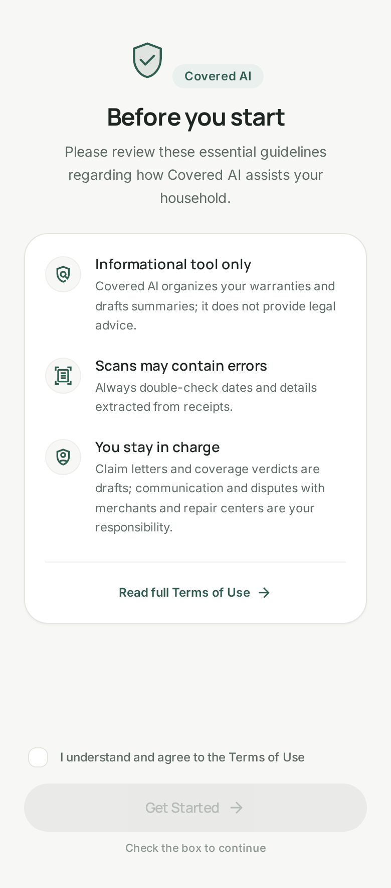
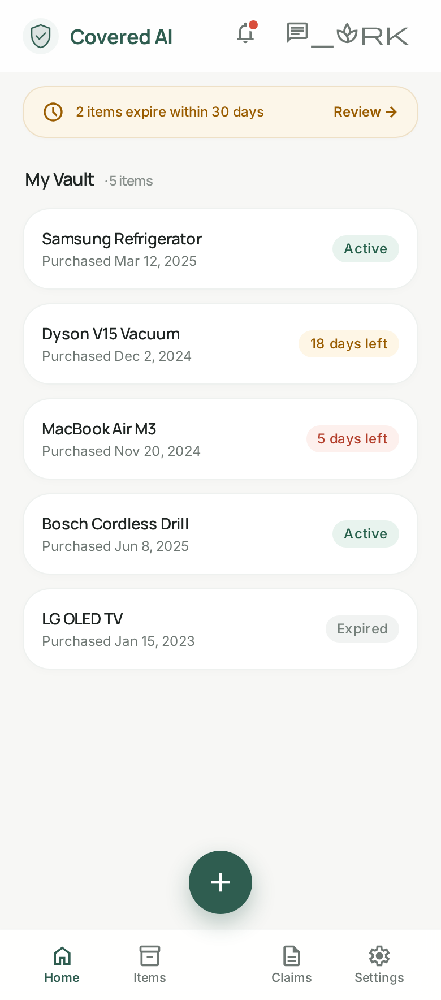
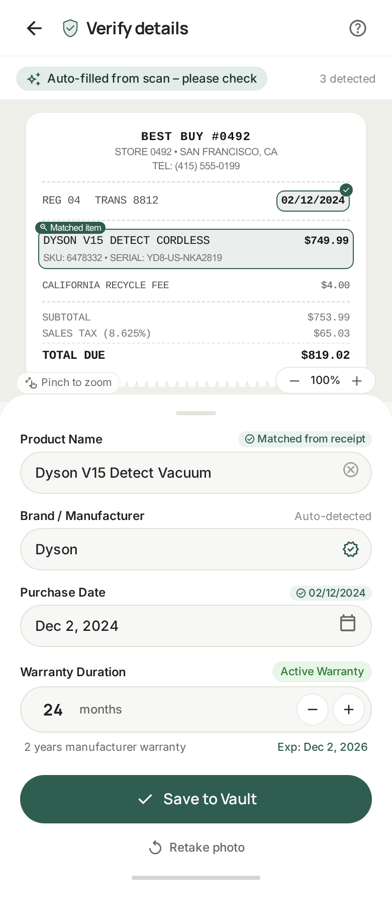
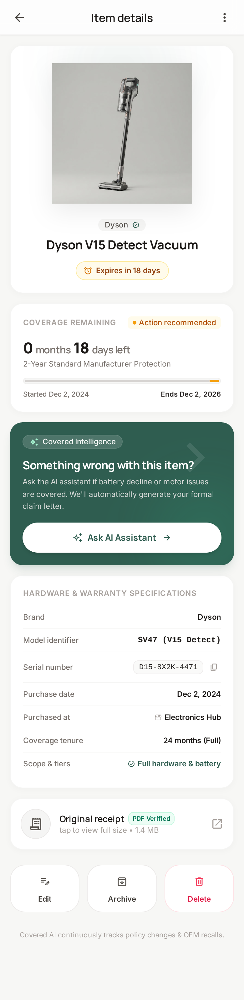
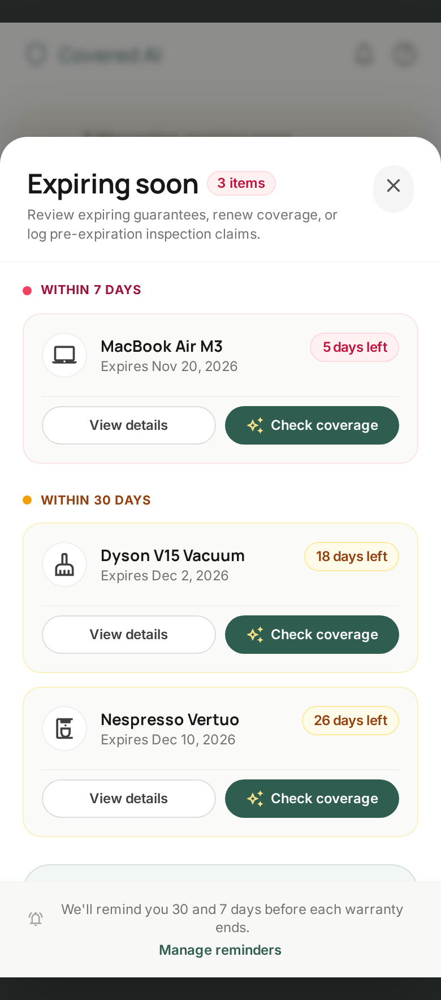
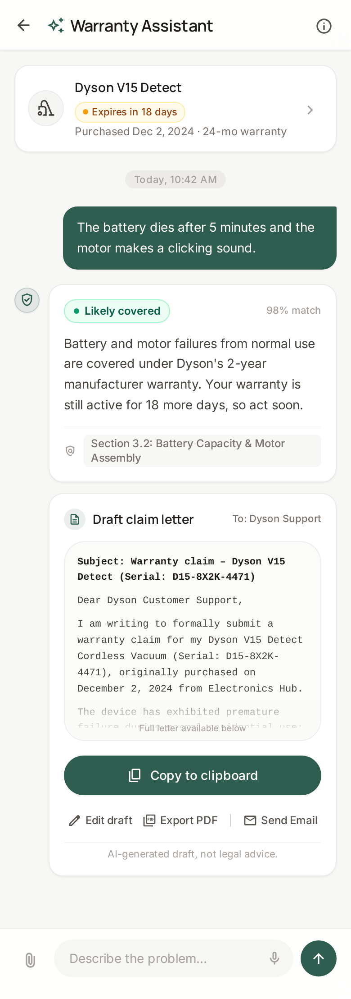

# Covered AI 🛡️

**A smart warranty vault for the household.** Covered AI turns paper receipts and dense warranty booklets into a digital vault. It tracks when each warranty expires, and when something breaks, its AI assistant tells you in plain language whether the problem is covered and drafts the claim letter for you.

> Student project, Data & Technology course.
> **Team:** Shira Rahamim · Bar Zuckermann · Noa Roash

---

## The problem

- Thermal receipts fade within months, and paper invoices get lost in drawers.
- Warranty terms are long and hard to read, so nobody reads them when an appliance breaks.
- In a survey of **30 people, 70%** had trouble finding a receipt or lost warranty coverage because they missed the expiration date. **87%** want to stop keeping paper altogether.

**Target user:** the *Household Manager*, the family member in charge of buying and maintaining dozens of appliances, electronics and tools.

## What the MVP does

| Feature | Description |
|---|---|
| 📷 **Fast ingestion** | Take a photo of a receipt or upload a PDF/JPG. Extraction fills in the product, brand, purchase date and warranty length, and you confirm them on an editable card. |
| 🔔 **Expiration reminders** | Push notifications **30 days** and **7 days** before a warranty expires. |
| 🤖 **AI assistant and claim letters** | Describe the problem in your own words. The assistant gives a coverage verdict and drafts a formal claim letter you can copy with one tap. |

> ⚖️ Covered AI is informational only and does not provide legal advice. Verdicts and claim letters are drafts, and dealing with stores and repair centers stays the user's responsibility.

## Screens

Designed in [Google Stitch](https://stitch.withgoogle.com/projects/3613266149126041490) (mobile).

| 0 · Onboarding | 1 · Home | 2 · Add item | 3 · Scan verification |
|---|---|---|---|
|  |  |  |  |

| 4 · Item details | 5 · Reminders | 6 · AI assistant |
|---|---|---|
|  |  |  |

### User flow

```
Onboarding ──accept──▶ Home
Home ── + ──▶ Add item ── scan/upload ──▶ Verify ── save ──▶ Home
Home ── tap item ──▶ Item details ── Ask AI ──▶ AI assistant
Home ── 🔔 ──▶ Reminders ── View details ──▶ Item details
                         └─ Check coverage ──▶ AI assistant
```

## Design language

- Minimalist and calm, with progressive disclosure: show only what's needed and reveal details on tap.
- **Primary color:** `#2F5D50` (deep sage) · **canvas:** `#F7F7F5`
- **Fonts:** Manrope for headlines, Inter for body text · 12px radius, pill-shaped buttons
- **Status badges:** 🟢 Active · 🟠 ≤30 days · 🔴 ≤7 days or expired · ⚪ Archived

## Success metrics

| Area | Target |
|---|---|
| Activation | 85% add an item in the first week; 5+ items per household within 30 days |
| Resolution | 80%+ clear AI verdicts, with a claim letter generated for each failure |
| Expiration rescue | 100% of reminders delivered; 0% warranties lost by accident |

## Repository contents

| File | Contents |
|---|---|
| [`Covered-AI-PRD.md`](Covered-AI-PRD.md) | The full PRD |
| [`Covered-AI-Stitch-Screens.md`](Covered-AI-Stitch-Screens.md) | Detailed screen spec and status in Stitch |
| [`stitch-screens/`](stitch-screens/) | Screenshots of all screens |
| [`CLAUDE.md`](CLAUDE.md) | Guidance for Claude Code working in the repo |

## Branches

- `main`: the stable, approved version
- `dev`: day-to-day work, merged into `main` after approval
